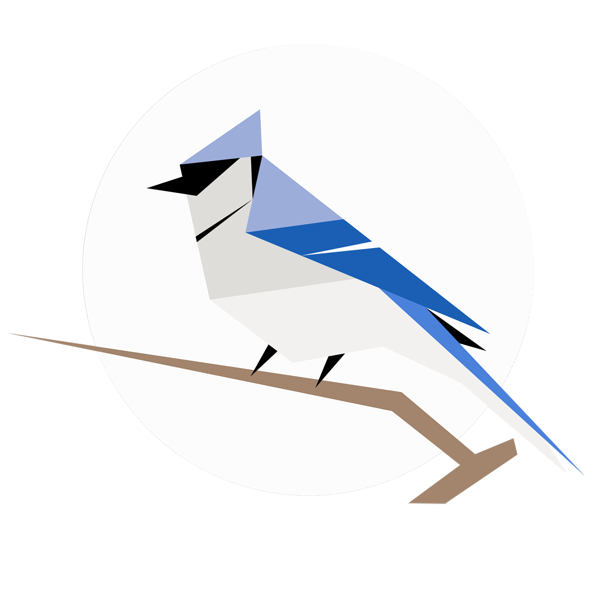

<div align="center"></div>

# real-time-pwa (BirdNET Live)

**BirdNET Live** is a Progressive Web App (PWA) that brings the power of the BirdNET acoustic identification algorithm directly to your web browser. It allows you to identify bird species from their sounds in real-time using your device's microphone (requires microphone permission).

Key features:
*   **Run offline**: All processing happens locally on your device using TensorFlow.js. No audio data is ever uploaded to a server (models and assets are downloaded once and stored locally).
*   **Real-Time Identification**: Visualizes sound via a spectrogram and provides instant species predictions.
*   **Location-Aware**: Uses your device's geolocation (optional) to filter predictions for species likely to be found in your area.
*   **BirdBox (optional)**: Draws boxes around bird sounds on the live spectrogram and names them with BirdNET V3.0 (see [BirdBox](#birdbox)).
*   **Offline Capable**: Once loaded, the app works without an internet connection.
*   **Cross-Platform**: Runs on desktop and mobile browsers (Chrome, Safari, Firefox, Edge).

⚠️ **Note**: This project is still in active development. Features and performance may vary across devices and browsers.

## Usage

You can access the live version of this project at: [https://birdnet-team.github.io/real-time-pwa/](https://birdnet-team.github.io/real-time-pwa/)

To install the PWA on your device, open the site in a compatible browser (e.g., Chrome, Edge, Firefox) and follow the prompts to add it to your home screen or desktop (choose "Install App" when prompted).

## Setup

1. Clone the repository:
   ```bash
   git clone https://github.com/birdnet-team/real-time-pwa.git
   cd real-time-pwa
   ```

2. Build and run the site locally:
   ```bash
   npm install
   npm run serve
   ```
   The first `npm run serve` or `npm run build` downloads the BirdBox and BirdNET V3.0 models (about 90 MB, see [BirdBox](#birdbox)).
3. Open your browser and navigate to `http://localhost:8080/real-time-pwa/` to view the site.

## BirdBox

With **Use BirdBox** switched on in the settings (it is off by default), the app draws boxes around bird sounds on the live spectrogram and names each box with a species. The main page always shows whether BirdBox is active, below the geolocation filter's state. It works like the BirdBox tab of the [BirdNET website demo](https://github.com/birdnet-team/birdnet-website) while it records, and most of the code in `public/js/birdbox/` is ported from there:

- [BirdBox](https://github.com/birdnet-team/BirdBox)'s Just-Bird model finds the boxes. It runs as a stream on the microphone's audio, converted to 32 kHz: each 3 s window is detected once, as soon as the audio reaches its end, so boxes appear about 1.5 s behind the sound. Boxes drawn dashed may still change with the next windows.
- BirdNET V3.0 names every box from the box's own audio: its time span (at least 1 s), with everything outside its frequency band, and the parts that smaller boxes inside it cover, replaced by background noise. A box is named after its best bird among the species heard clearly in some box since listening started, if its own score is at least half of that; other boxes stay unnamed. How clearly is the **BirdBox Species Threshold** (70 % by default, the website's species confidence): lower it if no box gets a species. With the geolocation filter on, only species the location model expects there are named.
- The settings have a **BirdBox** section, below **Spectrogram**, with the website's three sliders: **Box Confidence Threshold** (from which confidence BirdBox draws a box, 15 % by default), **Phrase Gap** (calls in one frequency band closer than this become one box, 0.05 s by default) and the **BirdBox Species Threshold**. The defaults are BirdBox's and the website's. Changes apply at once, also to the boxes already drawn; while BirdBox is off, the section is greyed out.

Both models run with [ONNX Runtime Web](https://onnxruntime.ai/) (WASM) in web workers. They are downloaded once (about 100 MB with the runtime), kept in the browser, and also work offline. BirdNET V3.0 takes about 500 MB of memory while BirdBox is on, so BirdBox needs a reasonably fast device. Audio and boxes are kept for the last two minutes only, so memory does not grow while the app listens.

The models are too large for this repository. `npm run build` and `npm run serve` first run `npm run fetch-models` (`scripts/fetch-models.mjs`), which downloads them from a pinned [Zenodo record](https://zenodo.org/records/24362980) (BirdNET+ V3.0 Global 12K, FP16 pruned) and a pinned BirdBox commit, checks their SHA-256, extracts BirdBox's two streaming graphs, and writes everything to `_models/` (gitignored). Eleventy publishes it as `/models/`, next to the BirdNET V2.4 files. The pins are the same as on the website; to update a model, change the record or commit and the hashes in the script.

## License

- **Source Code**: The source code for this project is licensed under the [MIT License](https://opensource.org/licenses/MIT).
- **Models**: The BirdNET V2.4 models in this repository are licensed under the [Creative Commons Attribution-ShareAlike 4.0 International License (CC BY-SA 4.0)](https://creativecommons.org/licenses/by-sa/4.0/).
- **BirdNET V3.0** (downloaded at build time, for BirdBox): the model weights are licensed under the [Apache License 2.0](https://www.apache.org/licenses/LICENSE-2.0) and come with an acceptable use policy (`MODEL_LICENSE.txt` and `ACCEPTABLE_USE.txt` in the [Zenodo record](https://zenodo.org/records/24362980)).
- **BirdBox** (downloaded at build time): the model weights are licensed under the [GNU Affero General Public License v3.0](https://www.gnu.org/licenses/agpl-3.0.html), in every format; see BirdBox's [licensing notice](https://github.com/birdnet-team/BirdBox/blob/main/NOTICE.md).

Please ensure you review and adhere to the specific license terms provided with each model.

## Citation

Feel free to use BirdNET for your acoustic analyses and research. If you do, please cite as:

```bibtex
@article{kahl2021birdnet,
  title={BirdNET: A deep learning solution for avian diversity monitoring},
  author={Kahl, Stefan and Wood, Connor M and Eibl, Maximilian and Klinck, Holger},
  journal={Ecological Informatics},
  volume={61},
  pages={101236},
  year={2021},
  publisher={Elsevier}
}
```

## Funding

Our work in the K. Lisa Yang Center for Conservation Bioacoustics is made possible by the generosity of K. Lisa Yang to advance innovative conservation technologies to inspire and inform the conservation of wildlife and habitats.

The development of BirdNET is supported by the German Federal Ministry of Research, Technology and Space (FKZ 01|S22072), the German Federal Ministry for the Environment, Climate Action, Nature Conservation and Nuclear Safety (FKZ 67KI31040E), the German Federal Ministry of Economic Affairs and Energy (FKZ 16KN095550), the Deutsche Bundesstiftung Umwelt (project 39263/01) and the European Social Fund.

## Partners

BirdNET is a joint effort of partners from academia and industry.
Without these partnerships, this project would not have been possible.
Thank you!


